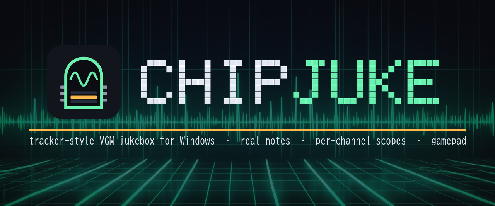
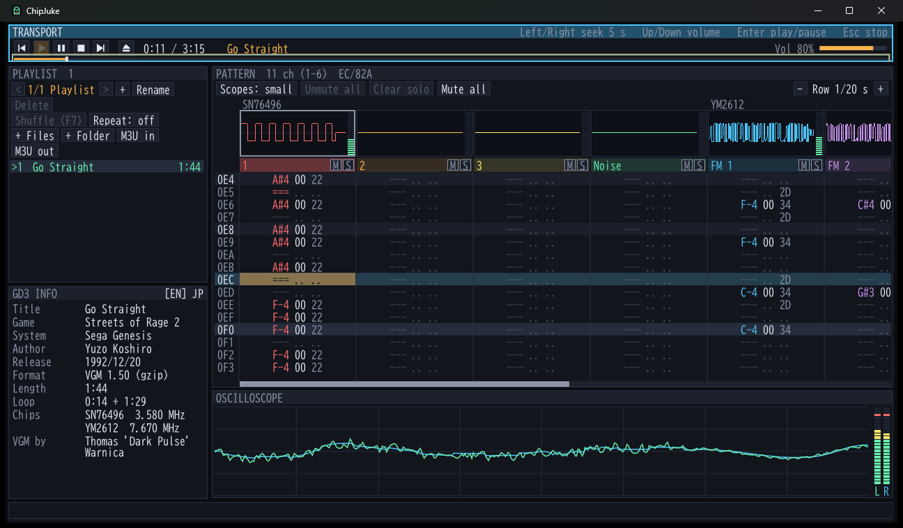
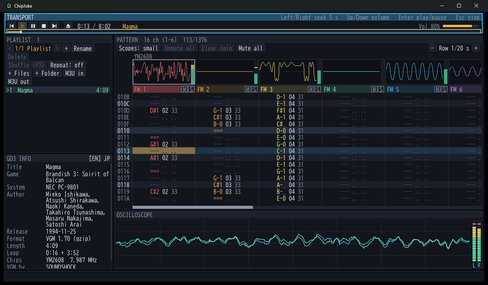

<p align="center">
  
</p>

<p align="center">
  <a href="https://github.com/C4rl0s79/ChipJuke/releases"></a>
  <a href="https://github.com/C4rl0s79/ChipJuke/actions/workflows/ci.yml"></a>
  
  <a href="LICENSE"></a>
</p>

<p align="center">
  <b>ChipJuke</b> plays VGM / VGZ chip music on Windows and shows what every channel is doing —<br>
  real notes read from the chip registers, an oscilloscope per channel, mute / solo — fully playable with a gamepad.
</p>

<p align="center">
  <a href="#download">Download</a> ·
  <a href="#features">Features</a> ·
  <a href="#controls">Controls</a> ·
  <a href="#building-from-source">Build</a> ·
  <a href="docs/user-guide.pl.md">Instrukcja (PL)</a> ·
  <a href="CHANGELOG.md">Changelog</a>
</p>

---

<p align="center">
  
  <br><sub><i>Streets of Rage 2 — SN76489 and YM2612: a scope per channel, real notes, mute / solo per column.</i></sub>
</p>

## Why ChipJuke

Most VGM players show a tag list and a progress bar. ChipJuke shows the music the way a tracker does
(FastTracker 2 layout): a strip of per-channel oscilloscopes on top and, always under it, a scrolling pattern with the
**notes, instruments and volumes the game actually wrote to the sound chip**. You can mute or solo any channel and hear
the result immediately, and you can do all of it from the couch with a gamepad.

| | |
|---|---|
| 🎹 **Real notes** | Decoded offline from register writes in the VGM stream — not guessed from audio. |
| 📈 **Scope per channel** | Each channel is rendered by its own copy of the emulated chip, so its scope is the real channel sound. |
| 🔇 **Mute / solo** | Per channel and globally, with ProTracker-style VU meters. |
| 🎮 **Gamepad first** | Every panel, dialog and the built-in file browser work with a pad; bindings are remappable. |
| 📂 **Jukebox** | Named playlists, M3U import/export, background folder scan, repeat / shuffle, session restore. |
| 📦 **One file** | A single portable `ChipJuke.exe` (~9 MB): libvgm, SDL3, Dear ImGui and the CRT are linked statically. |

## Download

Get **`ChipJuke-<version>-win64.zip`** from the [Releases](https://github.com/C4rl0s79/ChipJuke/releases) page.

1. *(optional)* Verify it in PowerShell: `Get-FileHash ChipJuke-<version>-win64.zip -Algorithm SHA256` must match `SHA256SUMS.txt`.
2. Extract the ZIP anywhere (for example `D:\Tools\ChipJuke`).
3. Run `ChipJuke.exe` and drop a `.vgm` / `.vgz` file or a whole folder onto the window.

**Requirements:** Windows 10 22H2 or newer (x64), a Direct3D 11 GPU driver and an audio output. Nothing to install —
no DLLs, no Visual C++ redistributable. To uninstall, delete the folder (and `%APPDATA%\ChipJuke`, if it was created).

The current version is **1.0.0-rc2**, a release candidate. Please report problems in
[Issues](https://github.com/C4rl0s79/ChipJuke/issues).

## Features

### Tracker view
- Oscilloscope strip (small / large / hidden, F4) with a VU meter per channel; master scope and stereo VU at the bottom.
- Pattern grid centred on the playing row; row length from 1/120 s to 1/10 s (default 1/20 s, `+` / `-`).
- Columns are wide and scroll horizontally together with the scopes when a chip has many channels.
- Notes are shown FT2-style (`C-4`, `===` for key-off), with instrument and volume columns.

### Chips with note decoding

<p align="center">
  
  <br><sub><i>Brandish 3 (NEC PC-9801) — YM2608 / OPNA, supported since 1.0.0-rc2.</i></sub>
</p>


| Family | Chips |
|---|---|
| PSG / square / wavetable | SN76489, AY8910, NES APU + FDS, Konami SCC (K051649) |
| Yamaha FM | YM2612 (incl. DAC), YM2151, YM2203, YM2608 (OPNA), YM2610/B (OPNB), YM2413, YM3812, YM3526, Y8950 (incl. ADPCM), YMF262 |
| PCM / ADPCM | SegaPCM, QSound (PCM voices), OKIM6295, OKIM6258, C140, K054539, K053260, GA20, YM2608/YM2610 ADPCM and rhythm |

Every other chip supported by libvgm **plays normally**; its columns show `...` instead of notes.
For PCM chips a "note" is relative: the same sample at the same rate shows the same note.

OPL4 (YMF278B, Moonsound) needs the Yamaha sample ROM `yrw801.rom` for its built-in instruments. It is not included;
put your own copy next to `ChipJuke.exe` or next to the track. Without it the Info panel shows a warning and ROM
instruments are silent.

### Playback
- VGM and gzip-compressed VGZ files.
- Loops twice by default with a 1 s fade-out; tunes without a loop end cleanly without a fade.
- Audio through WASAPI (miniaudio) with output device selection; the player falls back to the default device if the
  chosen one disappears.
- GD3 tags in English or Japanese (F3); UI in English or Polish (F2).

### Playlists and files
- Several named playlists, M3U / M3U8 import and export, drag & drop of files and folders.
- Folders are scanned in the background (`.vgm`, `.vgz`, `.vgm.gz`); titles and lengths fill in as files are read.
- Built-in file browser for the gamepad: drives, recent folders, multi-select, "add this folder", M3U export without typing.
- Settings, playlists and the last tune / position are restored on the next start.

### Robustness
- The loader validates every file before libvgm sees it (header offsets, data-block budgets, DAC streams, chip clocks).
- 10 libFuzzer targets (VGM header, command stream, GD3, gzip, decoder, pattern, settings, playlists, M3U, cache) with
  regression corpora; 470+ unit and integration tests.
- Network paths (`\\server\share`) are off by default because opening one can send your Windows credentials to that
  server; mapped network drives and links to shares are blocked in the file browser as well.

## Controls

Everything below can be remapped in **Settings (F10) → Bindings**.

<details open>
<summary><b>Gamepad</b> (Xbox layout — SDL maps other pads to it; works only while the window has focus)</summary>

| Control | Action |
|---|---|
| D-pad / left stick | Navigate (with auto-repeat) |
| A / B | Confirm / back |
| X | Solo (pattern) · remove entry (playlist) · add this folder (file browser) |
| Y | Menu · mark entry (file browser) |
| Start | Play / pause |
| LB / RB | Previous / next panel |
| LT / RT or L3 / R3 | Previous / next tune |
| Right stick up / down | Page up / down |
| Select | Oscilloscope strip height |

</details>

<details>
<summary><b>Keyboard and mouse</b></summary>

| Key | Action |
|---|---|
| Space | Play / pause |
| Esc | Stop · close a message · go back |
| P / N | Previous / next tune |
| Tab / Shift+Tab | Next / previous panel (Transport, Pattern, Playlist, Info) |
| ← / → (Transport) | Seek −5 / +5 s |
| `+` / `-` | Shorter / longer pattern row |
| M or Enter, S (Pattern) | Mute / solo the selected channel |
| 1…9, 0 / Shift+1…0 | Mute / solo channels 1–10 |
| U / C / R (Pattern) | Unmute all / clear solo / reset both |
| ↑ ↓, Enter, Delete (Playlist) | Select, play, remove; Ctrl+↑/↓ moves; ← / → switches playlist |
| Ctrl+O / Ctrl+Shift+O | Add files / add folder |
| Ctrl+I / Ctrl+E | Import / export M3U |
| F2 / F3 | UI language / GD3 language |
| F4 | Oscilloscope strip small / large / hidden |
| F6 / F7 | Repeat Off·All·One / shuffle |
| F8 / F9 / Shift+Delete | New / rename / delete playlist |
| F10 / F12 | Settings / diagnostics |

Mouse: click the position bar to seek, drag the volume bar, Shift+wheel scrolls channel columns, double-click plays an
entry, right click opens the entry menu, drop files or folders onto the window.

</details>

## Command line

```
ChipJuke.exe [options] [file.vgm | file.vgz | folder ...]
```

Arguments are added to the active playlist and played; without arguments the last session is restored (paused).

| Option | Meaning |
|---|---|
| `--pl` | Start with the Polish interface |
| `--settings-dir=<folder>` | Keep settings, playlists and cache in this folder |
| `--allow-network-paths` | Allow `\\server\share\...` paths (off by default) |
| `--no-autoplay` | Load without starting playback |
| `--null-audio` | No sound output (tests, CI) |
| `--diag` | Start with the diagnostics overlay (F12) |
| `--row-ticks=N` | Pattern row length in 44 100 Hz ticks (735 = 1/60 s) |
| `--scopes-large` / `--scopes-hidden` | Initial oscilloscope strip height |

### Where settings live

`settings.json`, `playlists.json` and `library-cache.json` are stored **next to `ChipJuke.exe`** when that folder is
writable (portable mode). Otherwise — for example under `C:\Program Files` — they go to `%APPDATA%\ChipJuke`.
Settings from the pre-release working name (`%APPDATA%\vgmplay`) are moved there automatically.

<details>
<summary><b>Network paths in detail</b></summary>

- UNC paths are rejected in playlists, M3U files and the session unless enabled in Settings or with
  `--allow-network-paths`. Turning the setting on asks for confirmation and takes effect immediately.
- In the file browser, drives mapped to a share (`net use Z: \\server\share`) are greyed out and cannot be entered;
  symbolic links and junctions are checked component by component without ever opening the share.
- Files and folders added from the command line, drag & drop or the browser go through the same check in the
  background worker, so mapped network drives are refused there too.
- M3U export from the built-in browser never overwrites: a taken name becomes `Name (2).m3u8`. In the Windows save
  dialog a confirmed "Replace" overwrites the file atomically.

</details>

## Building from source

Requirements: Visual Studio 2022 or Build Tools (MSVC x64, CMake, Ninja), Git and
[vcpkg](https://github.com/microsoft/vcpkg) with `VCPKG_ROOT` set.

```powershell
git clone --recurse-submodules https://github.com/C4rl0s79/ChipJuke
cd ChipJuke
powershell -NoProfile -ExecutionPolicy Bypass -File tools\dev-build.ps1   # configure + build + tests (Release)
powershell -NoProfile -ExecutionPolicy Bypass -File tools\package.ps1     # clean build + tests + portable ZIP
```

- Dependencies (SDL3, Dear ImGui, miniaudio, zlib, nlohmann-json) come from vcpkg in manifest mode, triplet
  `x64-windows-static`, pinned by `builtin-baseline`; libvgm is a git submodule built as a static library.
- The version has one source: `project(VERSION)` and `VGMPLAY_VERSION_SUFFIX` in `CMakeLists.txt`.
- `package.ps1` checks the result (no debug files, only system DLL dependencies) and writes a deterministic ZIP plus
  `SHA256SUMS.txt`. Pushing a `v*` tag runs [`release.yml`](.github/workflows/release.yml), which builds, tests and drafts a release.
- Fuzzing: [docs/testing/fuzzing.md](docs/testing/fuzzing.md) · manual release checklist:
  [docs/testing/release-checklist.md](docs/testing/release-checklist.md).
- Internal names in the code (`vgmplay::`, CMake targets) predate the ChipJuke name and are kept on purpose.

## Credits and licensing

ChipJuke is free software under **GPL-2.0-only** ([LICENSE](LICENSE)). Every release ZIP contains `SOURCE.txt` with the
exact commit it was built from.

- **[libvgm](https://github.com/ValleyBell/libvgm)** by Valley Bell — chip emulation and VGM playback, built statically
  into `ChipJuke.exe`. ChipJuke is an independent project and is not affiliated with libvgm or the VGMPlay player.
  Some libvgm cores carry their own licences and libvgm has no licence file upstream; see
  [docs/licensing/libvgm-audit.md](docs/licensing/libvgm-audit.md).
- [SDL3](https://libsdl.org), [Dear ImGui](https://github.com/ocornut/imgui), [miniaudio](https://miniaud.io),
  [zlib](https://zlib.net), [nlohmann/json](https://github.com/nlohmann/json), and the
  [BIZ UD Gothic](https://github.com/googlefonts/morisawa-biz-ud-gothic) font (SIL OFL 1.1).
  Full notices: [THIRD_PARTY_NOTICES.md](THIRD_PARTY_NOTICES.md) and `licenses/`.
- Brand and logo: [docs/brand/brand-guidelines.md](docs/brand/brand-guidelines.md).

VGM files are not included (the `samples\` folder holds short synthetic test files made by the project's generator).
Find rips at [vgmrips.net](https://vgmrips.net).
