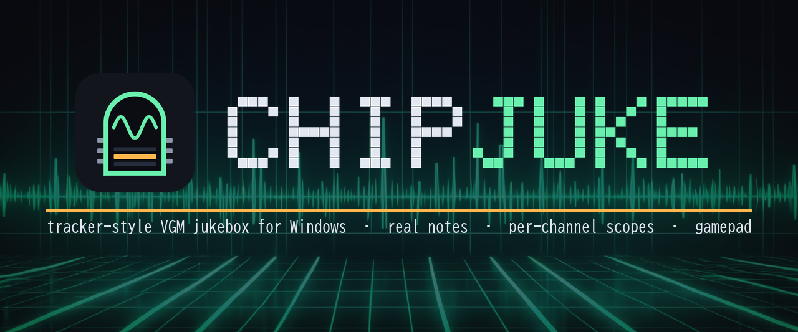

# ChipJuke — identyfikacja wizualna v1.0



ChipJuke to odtwarzacz plików VGM/VGZ dla Windows w stylu trackera (FastTracker 2):
prawdziwe nuty odczytane z rejestrów układów, oscyloskop na każdy kanał, playlisty i pełna obsługa padem.
Nazwa łączy **chip** (układ dźwiękowy konsoli i automatu) z **jukebox** (szafa grająca: wybierasz i słuchasz).

## Szybka ściąga

| Element | Wartość |
|---|---|
| Nazwa | **ChipJuke** — jedno słowo, wielkie C i J. Plik: `ChipJuke.exe` |
| Kolor główny | Mint `#69F0AE` |
| Akcent | Amber `#FFB74D` (kursor, jeden wyróżniony element) |
| Tło | Ink `#0B0D12`, Panel `#12151C` |
| Krój logotypu | własna siatka pikseli 5×7 (w `tools/brand/make_brand.py`) |
| Krój interfejsu | BIZ UD Gothic (SIL OFL 1.1, osadzony w exe) |
| Ton | rzeczowy, techniczny, z sympatią do sceny chiptune |

## 1. Znak

Znak to **szafa grająca zbudowana jak układ scalony**:

- łuk w kształcie szafy grającej, rysowany jedną grubą linią w kolorze mint;
- trzy piny po bokach, jak w obudowie DIP — to „chip”;
- w środku przebieg oscyloskopu (1,5 okresu sinusa), czyli to, co program pokazuje dla każdego kanału;
- pod nim trzy wiersze wzorca trackera, środkowy w kolorze amber, tak jak kursor odtwarzania w programie.

Znak przenosi tę samą kolejność co ekran programu: oscyloskopy na górze, wzorzec pod nimi.

### Warianty

| Wariant | Plik (`assets/brand/`) | Zastosowanie |
|---|---|---|
| Ikona pełna | `chipjuke-icon.svg`, `chipjuke-icon-{16…1024}.png` | ikona aplikacji, avatar repozytorium, kafelki |
| Ikona Windows | `chipjuke.ico` (16–256 px) | `ChipJuke.exe` (zasób `IDI_APP_ICON`) |
| Logo poziome | `chipjuke-logo-horizontal.svg/.png` | README, strona wydania, nagłówki |
| Logo poziome na jasnym | `chipjuke-logo-horizontal-on-light.svg`, `…-light.png` | dokumenty drukowane, jasne tła |
| Logotyp | `chipjuke-wordmark.svg/.png`, `…-on-light.svg` | gdy ikona jest już obok (np. pasek tytułu) |
| Jednobarwne | `chipjuke-icon-mono-light.svg`, `…-mono-dark.svg` | grawer, naklejki, jeden kolor |
| Banner i podgląd | `docs/images/banner.png`, `docs/images/social-preview.png` | góra README, podgląd linku w GitHub |

**Mały rozmiar.** Dla 32 px i mniej generator rysuje uproszczony znak: grubszy łuk, grubsza fala, bez pinów
i szarych wierszy (zostaje tylko wiersz amber). Nie zmniejszaj pełnej wersji poniżej 48 px — użyj PNG
z generatora albo `chipjuke.ico`, który ma oba warianty.

### Pole ochronne i minimalne rozmiary

- Pole ochronne wokół znaku i logo: **¼ wysokości ikony** z każdej strony.
- Ikona: minimum 16 px (wariant uproszczony).
- Logo poziome: minimum 120 px szerokości na ekranie.
- Logotyp pikselowy skaluj o całkowite wielokrotności siatki, gdy to możliwe (ostre krawędzie).

### Czego nie robić

- Nie obracaj, nie pochylaj i nie rozciągaj znaku.
- Nie zmieniaj kolorów łuku i fali (mint) ani wiersza kursora (amber); w wersji jednobarwnej wszystko w jednym kolorze.
- Nie dodawaj cieni, poświaty ani gradientów do znaku (poświata może być w tle, nie w znaku).
- Nie stawiaj pełnokolorowego logo na jasnych, jaskrawych zdjęciach — użyj wariantu „on light” albo jednobarwnego.
- Nie składaj nazwy innym krojem niż siatka pikseli w roli logo. W zwykłym tekście pisz „ChipJuke”.
- Nie używaj logotypów konsol, firm ani grafik z gier — ChipJuke jest niezależnym projektem.

## 2. Kolory

Paleta jest wspólna z interfejsem programu (`src/ui/theme.cpp`), żeby ekran i materiały wyglądały jak jedno.

### Podstawowe

| Nazwa | Hex | RGB | Użycie |
|---|---|---|---|
| Mint | `#69F0AE` | 105, 240, 174 | znak, oscyloskopy, „JUKE” w logotypie, stan „gra” |
| Amber | `#FFB74D` | 255, 183, 77 | kursor wzorca, jeden akcent na kompozycję |
| Ink | `#0B0D12` | 11, 13, 18 | tło okna i materiałów |
| Panel | `#12151C` | 18, 21, 28 | tło ikony, panele |

### Pomocnicze

| Nazwa | Hex | Użycie |
|---|---|---|
| Text | `#E3E8F0` | tekst, „CHIP” w logotypie |
| Dim | `#8C96A8` | tekst drugorzędny, piny znaku |
| Sky | `#4FC3F7` | fokus (ramka zaznaczenia), prawy kanał oscyloskopu |
| Row | `#252C3B` | wiersze wzorca, linie siatki |
| Line | `#2A3040` | obramowania |
| Mint Deep | `#1B9E63` | „JUKE” na jasnym tle |
| Paper | `#F4F6FA` | jasne tło dokumentów |

### Stany (jak w programie)

| Stan | Hex |
|---|---|
| Błąd / MUTE | `#FF6B6B` |
| Ostrzeżenie / SOLO | `#FFD54F` |
| VU niski / średni / wysoki | `#69F0AE` / `#FFEB6B` / `#FF6B6B` |

### Kontrast (WCAG)

| Pierwszy plan | na Ink `#0B0D12` | na Panel `#12151C` |
|---|---|---|
| Text `#E3E8F0` | 15,8:1 | 14,8:1 |
| Dim `#8C96A8` | 6,5:1 | 6,1:1 |
| Mint `#69F0AE` | 13,6:1 | 12,8:1 |
| Amber `#FFB74D` | 11,2:1 | 10,6:1 |
| Sky `#4FC3F7` | 9,7:1 | 9,1:1 |
| Error `#FF6B6B` | 7,0:1 | 6,6:1 |

Na jasnym tle (Paper): Ink 18,0:1; Mint Deep 3,2:1 — **tylko do logo i dużych elementów graficznych**,
nie do tekstu ciągłego. Tekst na kursorze amber: `#10131A` (10,7:1).

**Proporcje.** Około 80% ciemne tła, 15% tekst i mint, najwyżej 5% amber.

## 3. Typografia

| Rola | Krój | Uwagi |
|---|---|---|
| Logotyp | siatka pikseli 5×7, litery C H I P J U K E | rysowana przez generator, bez zewnętrznej licencji |
| Interfejs programu | BIZ UD Gothic Regular | osadzony w exe; obsługuje polskie znaki i japońskie tytuły GD3 |
| Banery i grafiki | BIZ UD Gothic Regular | podpisy pod logo, krótkie hasła |
| Dokumentacja (Markdown) | domyślny krój platformy | nie narzucamy |

Nie składaj długich tekstów siatką pikseli — tylko nazwa i krótkie etykiety.
Wartości trackera (nuty, numery wierszy, hex) zawsze krojem o stałej szerokości.

## 4. Grafika i obrazy

- **Tła:** ciemne granaty, przebiegi oscyloskopu i siatka w kolorze mint, delikatne linie CRT, dużo pustej
  przestrzeni pod logo. Tło banera jest wygenerowane lokalnie (ComfyUI, SDXL, Juggernaut XL) przez
  `tools/brand/comfy_banner_bg.py` (seed zapisany w pliku) i przyciemnione warstwą Ink 60%.
- **Zrzuty ekranu:** prawdziwy program na ciemnym motywie, 100% skali, bez nakładek systemowych (FPS, temperatury).
- Bez postaci, logotypów konsol i grafik z gier.

## 5. Głos i ton

| Cecha | Jesteśmy | Nie jesteśmy |
|---|---|---|
| Rzeczowi | nazywamy układy i funkcje wprost („YM2151, 8 kanałów FM”) | marketingowi („rewolucyjny dźwięk!”) |
| Techniczni z sympatią | mówimy językiem sceny (pattern, row, chip) i wyjaśniamy go | hermetyczni |
| Uczciwi | piszemy o ograniczeniach (np. „wybrzmiewanie po key-off nie jest pokazywane”) | obiecujący więcej niż kod |
| Dwujęzyczni | interfejs PL/EN, README po angielsku, instrukcja po polsku | mieszający języki w jednym zdaniu |

**Hasło:** *tracker-style VGM jukebox for Windows* / *szafa grająca VGM w stylu trackera*.

**Opis jednym zdaniem (EN):** ChipJuke plays VGM/VGZ chip music on Windows and shows what every channel
is doing — real notes, per-channel scopes, mute/solo — fully playable with a gamepad.

**Relacja z libvgm:** ChipJuke jest niezależnym projektem. Emulację układów zapewnia biblioteka
[libvgm](https://github.com/ValleyBell/libvgm) (Valley Bell), wbudowana statycznie w exe. Nie sugerujemy
powiązania z autorem libvgm ani z odtwarzaczem VGMPlay.

## 6. Pliki i odtwarzanie

```
python -I tools/brand/make_brand.py assets/brand                    # znak, logo, ICO, PNG
python -I tools/brand/comfy_banner_bg.py assets/brand/banner-background.png 1123335343   # opcjonalnie: tło (ComfyUI)
python -I tools/brand/make_banner.py assets/brand/banner-background.png assets/brand docs/images
```

Ikona aplikacji w exe pochodzi z `assets/brand/chipjuke.ico` (kopiowana do `src/app/`).
Zmiana kolorów: najpierw ten dokument, potem `make_brand.py` i `src/ui/theme.cpp`, na końcu ponowne wygenerowanie plików.
